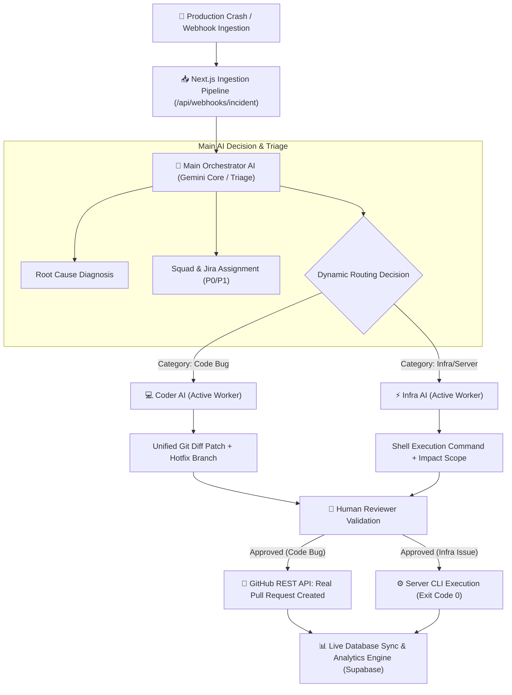

# AgentOps AI — Enterprise Multi-Agent Incident Remediation System
## Complete System Architecture & Documentation

---

## 1. Executive Summary

**AgentOps AI** is an autonomous, multi-agent Site Reliability Engineering (SRE) copilot built for high-velocity enterprise incident triage and remediation. Designed specifically for **Problem Statement 2 (Multi-Agent Systems & Task Delegation)**, the system replaces single-prompt LLM wrappers with a **hierarchical Manager-Worker orchestration pipeline**.

When an unhandled runtime error, memory leak, or infrastructure deadlock occurs in production, AgentOps:
1. Ingests raw telemetry and stack traces via standard webhooks (`/api/webhooks/incident`).
2. Directs the incident to the **Main Orchestrator AI (Gemini Core)** for anomaly detection, root cause diagnosis, squad dispatch, and routing.
3. Dynamically assigns the task to **strictly one specialized worker**:
   - **Coder AI**: Synthesizes a unified Git patch, commits a hotfix branch, and opens a real **GitHub Pull Request**.
   - **Infra AI**: Synthesizes a non-destructive shell command, determines the target environment, and executes **Server Infrastructure Mitigation**.
4. Enforces **Human-in-the-Loop (HITL)** governance — zero changes are deployed to servers or GitHub without explicit human approval.
5. Emits real-time telemetry to Supabase, driving an analytics engine with **100% real MTTR and ROI metrics**.

---

## 2. Multi-Agent System Architecture



### Agent Roles & Separation of Concerns

| Agent | Core Responsibility | Input | Output Artifact |
| :--- | :--- | :--- | :--- |
| **Main Orchestrator AI** | Anomaly detection, root cause identification, squad dispatch, and classification | Raw stack trace, microservice, environment | Root cause string, confidence score (%), Jira title, assigned squad, priority, routing decision (`coder_agent` vs `infra_agent`) |
| **Coder AI** *(Worker A)* | Source code modification and patch generation | Incident root cause, stack trace, target file | Modified file path, branch name (`hotfix/...`), unified Git diff patch, commit message |
| **Infra AI** *(Worker B)* | Infrastructure remediation, pod recycling, lock termination | Incident root cause, error log, service metadata | Monospace CLI command (e.g. `psql -c "SELECT pg_terminate_backend(PID)"` or `kubectl rollout restart`), target environment, estimated operational impact |

> [!IMPORTANT]
> **Dynamic Single-Worker Delegation:**
> The Main Orchestrator AI strictly delegates execution to **only one** worker agent based on problem taxonomy. If an incident is classified as an infrastructure failure (e.g. database deadlock), Coder AI is automatically placed in **Standby (Bypassed)**, preventing unwanted code churn. Conversely, software logic flaws place Infra AI in standby.

---

## 3. Application Map & UI Hierarchy

```
┌─────────────────────────────────────────────────────────────────────────────┐
│                            ← Back to Dashboard                              │
│                                                                             │
│  [Critical Severity]  INC-3dc46b39                                          │
│  OPS-5012: Database deadlock in billing-service Postgres ledger update      │
└─────────────────────────────────────────────────────────────────────────────┘

                                     │
                                     ▼
        ┌─────────────────────────────────────────────────────────────┐
        │            ✨ Main Orchestrator AI   [Gemini Core]  [98%]   │
        │                                                             │
        │  Diagnosis: Database deadlock detected in ledger update     │
        │  transaction (PID 1402), causing transaction abort.         │
        │                                                             │
        │  Squad: Payment Ops  •  Priority: P0  •  Routing: Infra AI  │
        └──────────────────────────────┬──────────────────────────────┘
                                       │
                      ┌────────────────┴────────────────┐
                      ▼                                 ▼
       ┌──────────────────────────────┐  ┌──────────────────────────────┐
       │      💻 Coder AI             │  │      ⚡ Infra AI             │
       │                              │  │                              │
       │   [ ⏸️ Bypassed by Main AI ]  │  │   [ 🟢 Assigned & Active ]   │
       │                              │  │                              │
       │   No source code change      │  │   Target: production         │
       │   needed for infrastructure  │  │   Impact: Terminates PID 1402│
       │   deadlock.                  │  │                              │
       │                              │  │   $ psql -U billing_admin... │
       │   (Standby - No PR needed)   │  │                              │
       │                              │  │   [ Approve & Execute Cmd ]  │
       └──────────────────────────────┘  └──────────────────────────────┘

                                     │
                                     ▼
┌─────────────────────────────────────────────────────────────────────────────┐
│ 📄 Original Error Telemetry (Clean Pure White Theme)                        │
│                                                                             │
│ 1  [2026-10-30T17:33:19Z] [FATAL] [billing-service] pid 1402               │
│ 2  ERROR: deadlock detected in Postgres ledger update at process 1402       │
│ 3      at PostgresPool.query (/app/node_modules/pg-pool/index.js:342:11)    │
│ 4      at LedgerRepository.updateBalance (/app/src/billing/ledger.ts:89:14) │
└─────────────────────────────────────────────────────────────────────────────┘
```

---

## 4. Database Schema & Data Integrity

The system uses **Supabase (PostgreSQL)** for persistence with real-time WebSocket subscriptions.

```sql
CREATE TABLE IF NOT EXISTS incidents (
  id UUID PRIMARY KEY DEFAULT gen_random_uuid(),
  title TEXT NOT NULL,
  service_name TEXT NOT NULL,
  environment TEXT NOT NULL DEFAULT 'production',
  severity TEXT NOT NULL CHECK (severity IN ('critical', 'high', 'medium', 'low')),
  status TEXT NOT NULL DEFAULT 'pending' CHECK (status IN ('pending', 'approved', 'rejected')),
  raw_log TEXT NOT NULL,
  stack_trace TEXT,
  ai_analysis JSONB,
  suggested_action JSONB,
  multi_agent_workflow JSONB,
  action_taken TEXT,           -- 'pull_request' | 'infra_command'
  executed_command TEXT,       -- CLI command executed for infra incidents
  pr_url TEXT,                 -- Real GitHub PR URL
  pr_number INT,               -- GitHub PR number
  pr_branch TEXT,              -- Target git branch
  approved_at TIMESTAMPTZ,
  rejected_at TIMESTAMPTZ,
  resolved_at TIMESTAMPTZ,     -- Timestamp when human authorized fix
  created_at TIMESTAMPTZ DEFAULT NOW(),
  updated_at TIMESTAMPTZ DEFAULT NOW()
);
```

---

## 5. 100% Real Analytics Engine (Zero Mock Data)

Unlike prototypes with hardcoded charts, AgentOps computes every metric dynamically from the live PostgreSQL database:

### 1. Mean Time to Resolution (MTTR)
For every resolved incident, the duration is computed as:
$$\text{Resolution Duration} = \text{resolved\_at} - \text{created\_at}$$
The system calculates the real average across all resolved rows (e.g. `1m 34s`) and computes actual percentage reduction against the manual 45-minute enterprise SRE baseline:
$$\text{Speedup} = \frac{2700\text{s} - \text{avgDuration}}{2700\text{s}} \times 100\%$$

### 2. Microservice Incident Distribution
Zero padding (`Math.max` removed). The bar chart groups incidents by exact `service_name` (`auth-service`, `billing-service`, `api-gateway`, `cache-layer`), showing exact total incoming vs automated resolved counts.

### 3. Engineering Hours & Cost Savings
Autonomous remediation reclaims an estimated **2.5 hours** of engineer context-switching, root cause research, and manual deployment verification per incident:
$$\text{Hours Saved} = \text{approved\_count} \times 2.5\text{ hrs}$$
$$\text{Financial ROI} = \text{Hours Saved} \times \$95/\text{hr (standard SRE contractor rate)}$$

### 4. Live Audit Trail
A dedicated table at the bottom of `/analytics` exposes live resolved records directly from Supabase, detailing:
- Incident Title & UUID
- Target Microservice
- Assigned Worker (`Coder AI (PR)` vs `Infra AI (Cmd)`)
- Actual Duration to Resolve
- Resolution Status

---

## 6. GitHub PR Automation Pipeline

When a **Coder AI** incident is approved:
1. `GET /repos/{owner}/{repo}/git/ref/heads/main` discovers base SHA.
2. `POST /repos/{owner}/{repo}/git/refs` generates branch `hotfix/{branch_name}-{timestamp}`.
3. `PUT /repos/{owner}/{repo}/contents/{filePath}` commits the unified patch.
4. `POST /repos/{owner}/{repo}/pulls` opens a Pull Request with complete metadata.
5. Database record is updated with `pr_url`, `pr_number`, and `pr_branch`.
6. UI transforms dynamically to render `[ View Pull Request #X on GitHub ↗ ]`.

---

## 7. Step-by-Step Evaluator Demo Guide

1. **Trigger Incident Ingestion (`/settings`):**
   - Click **"Send Error to AI"** on Preset 1 (*Database Deadlock*) or Preset 4 (*Missing JWT Secret*).
   - Real-time notification confirms ingestion.
2. **Observe Real-Time Queue (`/`):**
   - Notice the newly ingested incident appear instantly without browser refresh.
3. **Inspect Multi-Agent Orchestration (`/incident/[id]`):**
   - Verify the **Main Orchestrator AI** card at top center displaying root cause and dynamic routing decision.
   - For a deadlock: Verify **Infra AI** is Active with command `$ psql ... SELECT pg_terminate_backend(1402);` while **Coder AI** is in Standby.
   - For a code bug: Verify **Coder AI** is Active with unified Git diff while **Infra AI** is in Standby.
4. **Human-in-the-Loop Validation:**
   - Click **`Approve & Execute Command`** (Infra) or **`Approve & Open GitHub PR`** (Code).
   - Observe live toast, exit code 0 status, or real GitHub PR link.
5. **Verify Live Analytics (`/analytics`):**
   - Observe MTTR, Hours Saved, and the Audit Trail table update with real calculated metrics.

