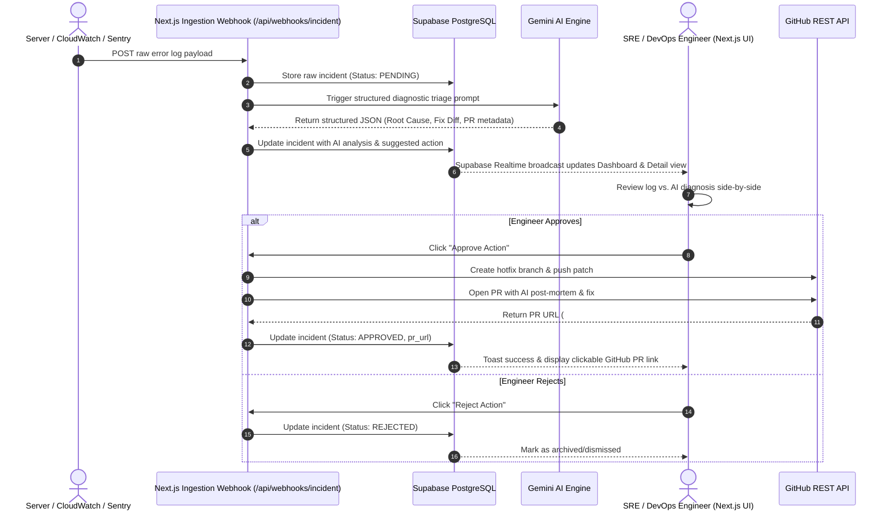

# Product Requirements Document (PRD)
## Project Name: AgentOps AI — Autonomous Incident Triage & Human-in-the-Loop Remediation

---

### 1. Executive Summary & Objective

Modern enterprise cloud infrastructure generates thousands of alerts, logs, and stack traces daily. When a critical production incident occurs, Site Reliability Engineers (SREs) and DevOps engineers spend between 30 to 90 minutes performing manual initial triage: parsing raw logs, inspecting git history, correlating error spikes, isolating root causes, and drafting emergency hotfixes or pull requests.

**AgentOps AI** is an enterprise-grade, agentic operations assistant designed to reduce Mean Time to Resolution (MTTR) by up to 90%. Built as a high-velocity SaaS prototype for a 24-hour hackathon, AgentOps AI ingests raw error streams via webhooks, leverages Google Gemini's advanced reasoning to conduct instant root-cause analysis, synthesizes precision code patches, and presents an interactive human-in-the-loop approval interface. With a single click, an engineer verifies the AI's diagnosis and automatically spawns a fully documented GitHub Pull Request targeting the broken repository.

---

### 2. Problem Statement & Market Opportunity

| Challenge | Current Manual Reality | AgentOps AI Solution |
| :--- | :--- | :--- |
| **Alert Fatigue** | Engineers drown in thousands of raw logs across Datadog, CloudWatch, and Sentry. | AI categorizes severity, deduplicates noise, and surfaces actionable root causes. |
| **Triage Latency** | Median initial diagnosis takes 35-45 minutes of manual log parsing. | Instantaneous (< 3s) multi-step diagnostic breakdown via Gemini structured output. |
| **Remediation Gap** | Diagnosing the bug is only step one; engineers still have to clone repos and write hotfix PRs. | Generates production-ready remediation code diffs with automated GitHub branch/PR creation. |
| **Enterprise Governance** | Unchecked autonomous agents running scripts directly on production servers is a compliance risk. | **Human-in-the-Loop (HITL)** safeguard: AI proposes, Engineer inspects & approves with 1 click. |

---

### 3. Target Audience & User Personas

#### Persona 1: Senior DevOps / SRE Lead ("Alex")
- **Responsibility:** On-call rotation lead, infrastructure uptime (99.99% SLA), post-mortem documentation.
- **Pain Point:** Being paged at 3:00 AM for known or repetitive failure modes; tedious log spelunking.
- **Goal:** Receive a high-signal notification with root cause already isolated and a pull request ready to review.

#### Persona 2: VP of Infrastructure / Engineering Director ("Sarah")
- **Responsibility:** Engineering velocity, MTTR metrics, incident cost management, security governance.
- **Pain Point:** High MTTR costs the company \$5,400 per minute in downtime; uncontrolled autonomous agents frighten auditors.
- **Goal:** Clear visibility into automated vs. manual triage metrics and provable ROI dashboards with strict HITL controls.

---

### 4. End-to-End System Workflow

---

### 5. Scope & Feature Prioritization (MoSCoW Matrix)

#### 5.1 Core Features (P0 - In Scope for Hackathon Prototype)
1. **High-Speed Ingestion Webhook:** Public HTTP endpoint (`POST /api/webhooks/incident`) accepting JSON incident payloads (raw stack traces, service name, environment, metadata).
2. **Gemini Agentic Triage Engine:** Zero-shot and few-shot prompt chaining using Gemini's JSON mode to produce deterministic analysis:
   - Error classification & severity rating (`CRITICAL`, `HIGH`, `MEDIUM`, `LOW`).
   - Root-cause explanation in plain English.
   - Code patch / remediation recommendation (file path, exact diff, commit message, PR description).
3. **Real-time Incident Dashboard:**
   - 3 Live KPI Cards: Total Incidents, Pending Review, Resolved / Approved.
   - Live Supabase Realtime table updating instantly upon log ingestion without page reload.
4. **Interactive Incident Detail & Approval Console:**
   - Split-screen UI: Terminal error viewer with raw logs on the left; AI diagnostic card with code diff on the right.
   - Prominent "Approve Action" (Green) and "Reject" (Red) action controls.
5. **Automated GitHub PR Creation:**
   - On approval, serverless route connects via GitHub REST API, creates an issue/branch, commits the patch, opens a Pull Request, and returns the live GitHub link to the user interface.
6. **Judge Simulator & Settings Page:**
   - Interactive panel allowing judges or evaluators to trigger simulated production incidents with one click (e.g., OOM Kill, Database Connection Pool Exhaustion, Corrupted JWT Token) or send custom logs.
7. **Executive ROI & Analytics Dashboard:**
   - Recharts visual charts proving business metrics: Mean Time to Resolution drop, Engineering hours saved, Automated vs. Manual resolutions.

#### 5.2 Out of Scope (P1 / Future Post-Hackathon Roadmap)
- Complex Multi-Tenant RBAC & OAuth2 enterprise Single Sign-On (Okta/SAML).
- Direct SSH/Bastion execution of live server terminal commands.
- Multi-cloud infrastructure provisioning (Terraform/Pulumi automation).
- Bidirectional PagerDuty/Slack live bot threading (simulated via Webhook/UI for demo).

---

### 6. Functional Requirements

| ID | Requirement | Description | Acceptance Criteria |
| :--- | :--- | :--- | :--- |
| **FR-01** | Webhook Ingestion | Endpoint accepts structured JSON with raw error log. | Returns HTTP 201 with generated Incident UUID within 500ms. |
| **FR-02** | Gemini Triage Processing | Incoming incident is immediately processed by Gemini. | Enforces strict JSON schema: `root_cause`, `suggested_fix`, `severity`. |
| **FR-03** | Realtime UI Streaming | UI reflects newly ingested incidents without manual page refresh. | Supabase postgres_changes listener updates UI table in < 1 second. |
| **FR-04** | Split-Pane Inspection | Side-by-side terminal log view and structured AI diagnosis. | Monospace formatted log viewer with copy-to-clipboard functionality. |
| **FR-05** | Human Approval Flow | Single click triggers remediation workflow. | Button enters loading state, invokes GitHub API, displays PR link badge. |
| **FR-06** | Incident Rejection | Engineer can reject erroneous or unneeded AI recommendations. | Status changes to `rejected`, row dims, action logged in audit trail. |
| **FR-07** | Live Error Simulator | Dedicated judge demo tool with pre-canned error scenarios. | Pre-configured buttons inject dummy errors into the webhook live. |
| **FR-08** | Analytics & ROI Graphs | Interactive graphs showing MTTR and saved developer hours. | Recharts rendering dynamic metrics based on Supabase incident records. |

---

### 7. Non-Functional Requirements (Hackathon Optimized)

- **Response Latency:** Webhook ingestion acknowledgement < 800ms; AI triage completion < 4.5s.
- **Aesthetic Standard:** Modern "Dark-Mode First" DevOps console; sleek typography (Inter + JetBrains Mono), glowing status badges, high-contrast indicators.
- **Reliability & Graceful Degradation:** If GitHub token is omitted or rate-limited, fallback to an interactive "Simulated PR" mode showing the exact payload that would be sent.
- **Portability:** Zero local database installs required; runs seamlessly using Supabase Cloud and Vercel hosting.

---

### 8. Hackathon Pitch & Live Demo Script Flow

1. **The Hook (0:00 - 0:45):** Demonstrate the problem of alert fatigue. Open a noisy terminal with an unreadable stack trace.
2. **The Ingestion (0:45 - 1:15):** Switch to the `/settings` simulator page. Click "Trigger Production OOM Incident". Show webhook ingestion.
3. **The Realtime Detection (1:15 - 1:45):** Without touching the browser refresh button, switch to `/` (Dashboard). Watch the KPI card bump and the critical incident appear with glowing status badges.
4. **The AI Diagnosis (1:45 - 2:30):** Click into `/incident/[id]`. Show the split screen: raw stack trace vs. Gemini's root cause analysis and synthesized code diff.
5. **The Magic HITL Moment (2:30 - 3:00):** Click "Approve Action". Watch the loader, toast confirmation, and instant GitHub Pull Request URL badge appear. Click the link to show the actual GitHub PR created live.
6. **The Business Value (3:00 - 3:30):** Navigate to `/analytics`. Show how this automated workflow dropped resolution time from 45 minutes to 90 seconds, saving thousands in developer hours.

