# 24-Hour Hackathon Execution Roadmap & Milestone Plan
## Project Name: AgentOps AI — Enterprise SaaS Incident Assistant

---

### 1. 24-Hour Countdown Timeline Overview

```mermaid
gantt
    title 24-Hour Hackathon Sprint Schedule
    dateFormat  HH:mm
    axisFormat %H:%M

    section Phase 1: Setup
    Supabase Provisioning & SQL Schema       :00:00, 1h
    Next.js 14 Init & Tailwind/shadcn Setup   :01:00, 2h

    section Phase 2: UI Shell
    Global Sidebar & Page Shells             :03:00, 2h
    Dashboard KPI Cards & Incidents Table    :05:00, 2h

    section Phase 3: Agent Engine
    Webhook Ingestion API Route              :07:00, 2h
    Gemini Structured Output Triage Pipeline :09:00, 3h

    section Phase 4: HITL & GitHub
    Detail Split-View & Approval Dock        :12:00, 2.5h
    GitHub REST API Branch & PR Automation   :14:30, 2.5h
    Supabase Realtime Live Channel Sync      :17:00, 1.5h

    section Phase 5: Polish & Pitch
    Judge Demo Simulator (/settings)         :18:30, 1.5h
    Recharts ROI Analytics (/analytics)      :20:00, 1.5h
    End-to-End Rehearsal & Vercel Deploy     :21:30, 1.5h
    Slide Deck & Video Pitch Finalization    :23:00, 1h
```

---

### 2. Phase-by-Phase Breakdown

---

#### Phase 1: Foundation, DB Setup & Project Scaffolding (Hours 00:00 – 03:00)
- **Objective:** Establish the development environment, database schema, and design dependencies.
- **Tasks:**
  1. Initialize Next.js 14 project with App Router, TypeScript, ESLint, and Tailwind CSS.
  2. Install core dependencies: `@supabase/supabase-js`, `@google/genai` (or `@google/generative-ai`), `lucide-react`, `recharts`, `sonner`, `clsx`, `tailwind-merge`.
  3. Execute SQL migration in Supabase SQL editor:
     - Create `incident_severity` & `incident_status` enums.
     - Create `incidents` table with JSONB fields.
     - Enable `supabase_realtime` publication on `incidents`.
     - Seed demo records for immediate verification.
  4. Create `.env.local` with Supabase, Gemini, and GitHub credentials.
- **Verification Milestone:** Supabase client connects successfully; Next.js dev server boots clean on `localhost:3000`.

---

#### Phase 2: Design System & Core UI Components (Hours 03:00 – 07:00)
- **Objective:** Construct the high-fidelity dark-mode UI shell and foundational screens.
- **Tasks:**
  1. Build `Sidebar` navigation rail with active route highlighting and live telemetry status dots.
  2. Implement Page 1: Dashboard (`/`):
     - 3 Top KPI Cards (`Total Incidents`, `Pending Review`, `Resolved / Remediated`).
     - Real-time data table with severity badges, service pills, time-ago formatting, and row click navigation.
  3. Implement layout skeleton for `/incident/[id]`, `/settings`, and `/analytics`.
- **Verification Milestone:** Navigating between all 4 routes works seamlessly; UI visually matches the dark-mode cyber-devops aesthetic.

---

#### Phase 3: Webhook Ingestion & Gemini AI Triage Engine (Hours 07:00 – 12:00)
- **Objective:** Create the autonomous backend brain that diagnoses errors and generates fixes.
- **Tasks:**
  1. Implement `POST /api/webhooks/incident`:
     - Validate incoming JSON payload.
     - Save pending incident to Supabase.
  2. Implement `lib/gemini.ts` triage service:
     - Connect via official Gemini SDK.
     - Inject system instructions for the Principal SRE persona.
     - Configure strict JSON schema for structured diagnosis (`root_cause`, `suggested_action`, `patch_content`).
  3. Chain the webhook: Upon log arrival, immediately trigger Gemini triage and update the incident in Supabase.
- **Verification Milestone:** Firing a test cURL command inserts a record, runs Gemini analysis, and updates Supabase within 3 seconds.

---

#### Phase 4: Incident Detail View, GitHub Automation & Realtime Sync (Hours 12:00 – 18:30)
- **Objective:** Implement the human-in-the-loop approval mechanism and automated remediation pipeline.
- **Tasks:**
  1. Implement Page 2: Incident Detail & Approval (`/incident/[id]`):
     - Split screen: Left terminal view with syntax-styled error log and copy buttons; Right panel with Gemini analysis, root cause, and unified diff preview.
     - Action Dock: Green "Approve Action" and Red "Reject" buttons.
  2. Implement `POST /api/incidents/[id]/approve`:
     - GitHub API automation: create branch `hotfix/inc-{id}`, commit patch, open Pull Request.
     - Save `pr_url` and update status to `approved`.
     - Graceful offline fallback: If GitHub token is omitted, generate simulated PR link to guarantee demo reliability.
  3. Connect Supabase Realtime listeners:
     - Dashboard table updates dynamically when new incidents are ingested or approved without page refresh.
- **Verification Milestone:** Approving an incident from the UI opens a real Pull Request on GitHub and reflects immediately across the interface.

---

#### Phase 5: Demo Simulator, ROI Analytics & Final Polish (Hours 18:30 – 24:00)
- **Objective:** Equip the app for judge interaction, business value demonstration, and deployment.
- **Tasks:**
  1. Implement Page 3: Settings & Simulator (`/settings`):
     - Dedicated judge view displaying public webhook URL and quick cURL snippets.
     - Pre-configured one-click error buttons (OOM Heap, Redis Timeout, Postgres Deadlock, JWT Nil Pointer).
     - Interactive custom payload sender.
  2. Implement Page 4: Analytics & ROI (`/analytics`):
     - Business impact summary cards (MTTR drop, Hours Saved, Cost Avoided).
     - Recharts Area/Bar Chart ("Manual Hours Saved Over Time").
     - Recharts Donut Chart ("Automated vs Manual Resolutions").
  3. Deploy to Vercel and verify live production endpoints.
  4. Perform 3 complete dry runs of the 3-minute pitch script.
- **Verification Milestone:** Zero console errors, fully responsive presentation, live demo tested under simulated network conditions.

---

### 3. Risk Mitigation & Contingency Strategy

| Potential Hazard | Impact | Preemptive Fallback Plan |
| :--- | :--- | :--- |
| **Gemini API Rate Limiting** | High | Built-in smart mock fallbacks in `lib/gemini.ts` that return pre-computed high-fidelity diagnoses if the Gemini quota is exceeded. |
| **GitHub Token Permission Issue** | High | Auto-detect token failure and gracefully switch to "Simulated GitHub Mode" displaying full PR diffs with an interactive mock URL. |
| **Slow Wi-Fi during Demo** | Critical | Optimistic UI updates ensure all button clicks and status changes render immediately before network confirmation. |
| **Database Connection Flakiness** | Medium | Local caching layer using browser `localStorage` to preserve demo states if Supabase network stutters. |

---

### 4. Definition of Done for Hackathon Submission

- [x] Full source code committed to GitHub repository.
- [x] Live production app deployed and accessible on Vercel.
- [x] Ingestion webhook accepting external error logs.
- [x] Gemini AI producing structured root-cause analyses and Git patches.
- [x] Realtime Supabase dashboard broadcasting events with zero refresh.
- [x] Human-in-the-loop approval successfully creating GitHub Pull Requests.
- [x] Dedicated Judge Simulator page allowing 1-click live testing.
- [x] ROI & Analytics charts demonstrating business value.
- [x] 3-minute pitch deck and video demo recorded.

