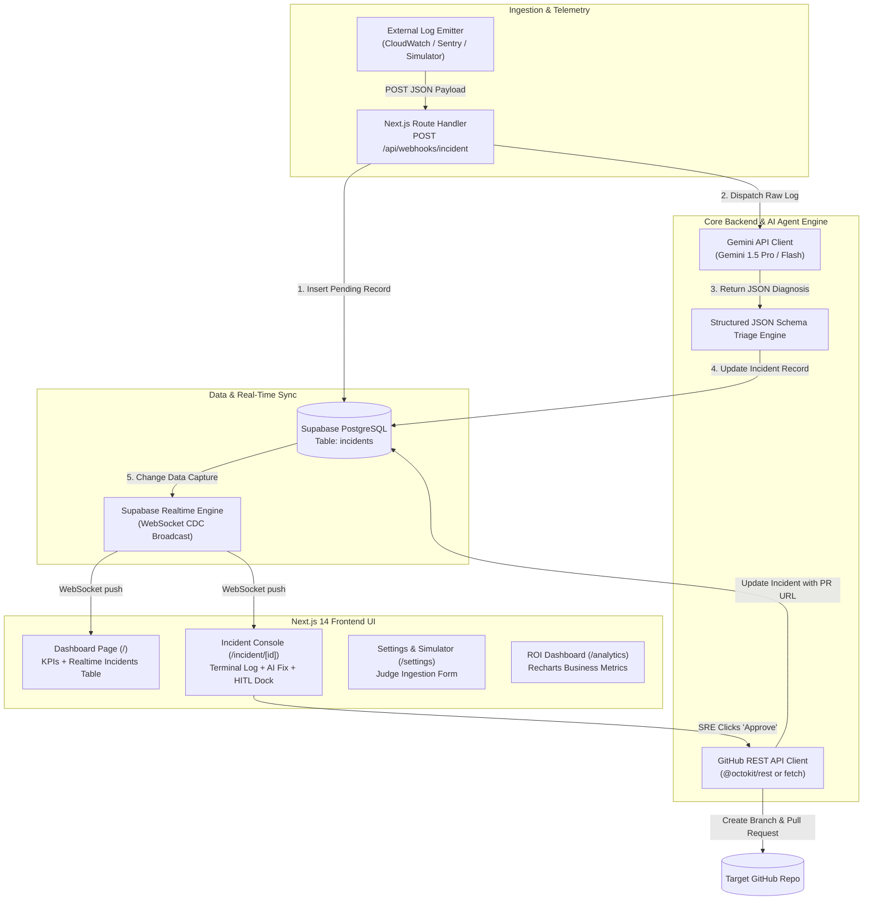

# Technical Architecture & Stack Specification
## Project Name: AgentOps AI

---

### 1. High-Level System Architecture



---

### 2. Technology Stack Breakdown

| Layer | Technology | Version | Justification for Hackathon |
| :--- | :--- | :--- | :--- |
| **Framework** | Next.js (App Router) | `14.2.x` | Unified full-stack framework with React Server Components, zero-boilerplate API route handlers, and rapid hot reloading. |
| **Language** | TypeScript | `5.x` | Strict type safety across DB entities, Gemini structured response schemas, and API request/response payloads. |
| **Styling & UI** | Tailwind CSS + shadcn/ui | `3.4.x` / Radix | Unmatched component build velocity, accessible keyboard navigation, dark mode support out-of-the-box. |
| **Icons & Visuals** | Lucide React | Latest | Clean, consistent, lightweight SVG icon set for modern devops UI. |
| **Data Visualization**| Recharts | `2.12.x` | Fast, reactive charting for the ROI & Analytics dashboard (Area, Bar, Donut charts). |
| **Database** | Supabase (PostgreSQL) | Managed Cloud | Hosted Postgres with zero local setup, instant schema provisioning, and native Realtime change-data-capture. |
| **Realtime Sync** | `@supabase/supabase-js` | `2.x` | Browser-level WebSocket subscriptions listening to `postgres_changes` on the `incidents` table. |
| **AI Intelligence** | Google Gemini API | `1.5 Pro` / `Flash` | Leading reasoning capability for deep code analysis, native JSON mode for deterministic parsing, generous free-tier token limits. |
| **VCS Integration** | GitHub REST API | v3 | Direct programmatic creation of branches, git commits, and Pull Requests with rich markdown bodies. |
| **Notifications** | Sonner | Latest | Smooth, aesthetic toast notifications for real-time approvals and alerts. |
| **Hosting & CI/CD** | Vercel | Global Edge | One-click deployment from GitHub with automatic HTTPS and environment variable injection. |

---

### 3. Subsystem Architecture & Implementation Details

#### 3.1 Next.js App Router Structure
```
src/
├── app/
│   ├── layout.tsx                # Global Shell (Sidebar + Providers + Toaster)
│   ├── page.tsx                  # Main Incidents Dashboard (/)
│   ├── incident/
│   │   └── [id]/
│   │       └── page.tsx          # Incident Detail & Approval Console
│   ├── settings/
│   │   └── page.tsx              # Judge Demo & Webhook Simulator
│   ├── analytics/
│   │   └── page.tsx              # Recharts ROI Dashboard
│   └── api/
│       ├── webhooks/
│       │   └── incident/
│       │       └── route.ts      # Ingestion Webhook (POST)
│       └── incidents/
│           ├── route.ts          # Fetch & List Incidents (GET)
│           └── [id]/
│               ├── approve/
│               │   └── route.ts  # GitHub PR Creation & Approval (POST)
│               └── reject/
│                   └── route.ts  # Incident Dismissal (POST)
├── components/
│   ├── sidebar.tsx               # Global Navigation Rail
│   ├── kpi-card.tsx              # Dashboard Metric Cards
│   ├── incident-table.tsx        # Realtime Incidents Table with Badges
│   ├── terminal-viewer.tsx       # Syntax-highlighted Terminal Log Viewer
│   ├── ai-remediation-card.tsx   # Code Diff Preview & AI Diagnostic Card
│   ├── approval-dock.tsx         # Bottom Action Dock (Approve / Reject)
│   ├── webhook-tester.tsx        # Judge Simulator Form with Presets
│   └── roi-charts.tsx            # Recharts Visualizations
└── lib/
    ├── supabase/
    │   ├── client.ts             # Browser Supabase client (Realtime)
    │   └── server.ts             # Service-role Server Supabase client
    ├── gemini.ts                 # Gemini Client & Prompt Triage Handler
    ├── github.ts                 # GitHub API wrapper for Branch & PR creation
    └── types.ts                  # Shared TypeScript interfaces
```

---

#### 3.2 Supabase Realtime Architecture

To deliver an instantaneous "wow" factor during judge evaluations, the dashboard never requires a manual page reload.

1. **Client Subscription:** The `incident-table.tsx` component mounts a Supabase Realtime channel listening to table changes:
   ```typescript
   const channel = supabase
     .channel('incidents-realtime')
     .on(
       'postgres_changes',
       { event: '*', schema: 'public', table: 'incidents' },
       (payload) => {
         handleRealtimeEvent(payload);
       }
     )
     .subscribe();
   ```
2. **Event Handling:**
   - `INSERT`: Prepend newly ingested incident to the table with an animated pulse.
   - `UPDATE`: Update the incident status (e.g. from `pending` to `approved`) and display the generated PR link badge.

---

#### 3.3 Google Gemini API Agentic Triage

The incident triage engine uses Gemini with structured outputs (`responseMimeType: "application/json"`) to ensure 100% deterministic parsing.

- **Model Selection:** `gemini-1.5-pro` (or `gemini-1.5-flash` for ultra-fast < 2s response).
- **Prompt Strategy:**
  - System Instructions enforce the persona of a Principal SRE and Linux Kernel/Node.js Specialist.
  - The model inspects the error trace, determines the exact line of failure, assesses root cause, assigns a standard severity rating, and crafts an actionable Git patch diff.
- **Fail-Safe Mechanism:** If Gemini API encounters rate-limiting during demo, a robust fallback analyzer activates to generate a high-fidelity synthetic triage response so the demo never crashes.

---

#### 3.4 GitHub REST API Automation

When the engineer clicks "Approve Action", the serverless route (`/api/incidents/[id]/approve`) executes the following sequential calls:
1. **Fetch Target Repo Reference:** `GET /repos/{owner}/{repo}/git/ref/heads/main` to get latest base commit SHA.
2. **Create Hotfix Branch:** `POST /repos/{owner}/{repo}/git/refs` creating `heads/hotfix/incident-{id}`.
3. **Commit Patch / Update File:** `PUT /repos/{owner}/{repo}/contents/{path}` with the proposed remediation code.
4. **Open Pull Request:** `POST /repos/{owner}/{repo}/pulls` with:
   - `title`: `fix(sre): [INC-{id}] {AI proposed title}`
   - `head`: `hotfix/incident-{id}`
   - `base`: `main`
   - `body`: Detailed Markdown report containing Root Cause, Gemini Analysis, and SRE Approval signature.
5. **Fallback Simulation Mode:** If `GITHUB_TOKEN` is not configured, the API generates a simulated GitHub PR record with a mock PR URL, ensuring seamless offline demo capability for hackathon judges.

---

### 4. Environment Variables Specification

```env
# Supabase Configuration
NEXT_PUBLIC_SUPABASE_URL=https://xyzcompany.supabase.co
NEXT_PUBLIC_SUPABASE_ANON_KEY=eyJhbGciOi...
SUPABASE_SERVICE_ROLE_KEY=eyJhbGciOi...

# Google Gemini API
GEMINI_API_KEY=AIzaSy...

# GitHub Integration
GITHUB_TOKEN=ghp_...
GITHUB_OWNER=octocat
GITHUB_REPO=incident-demo-repo

# App Base URL (for webhook references)
NEXT_PUBLIC_APP_URL=http://localhost:3000
```

